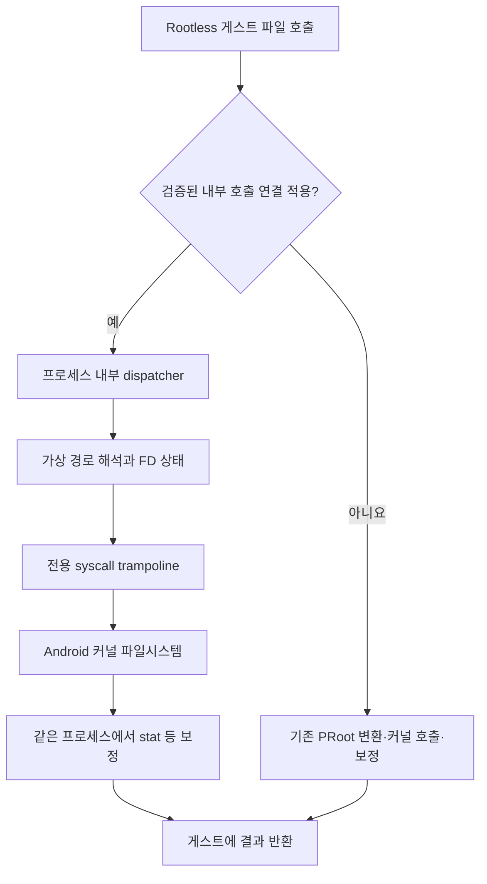

# Rootless 파일 작업 가속 재설계안

작성일: 2026-09-14. 상태: **제안, 구현·성능 검증 전**.
기존에 구현한 작은 최적화와 측정은
[ROOTLESS_PERFORMANCE.md](ROOTLESS_PERFORMANCE.md)에 기록한다.

## 결론과 범위

가장 유망한 방향은 **자주 사용하는 파일 호출의 경로 변환과 반환값 보정을
게스트 프로세스 내부에서 수행하고, 그 호출을 PRoot의 ptrace 추적에서 제외하는 것**이다.
기존 Android 커널과 app-private 파일시스템을 그대로 사용한다.
별도 파일 서버를 모든 작업에 끼워 넣지 않는다.

첫 단계는 PRoot를 유지하는 혼합 방식이다. 지원하는 glibc 호출에는 내부
dispatcher를 적용하고 나머지는 기존 PRoot가 처리한다. 이후 커널 경로 해석,
실제 하드링크와 FD 추적을 결합한다. ptrace를 완전히 제거하는 방식은
정적 바이너리, 시그널, exec까지 처리하는 별도 후속 단계다.

권한 없는 Rootless 환경 안에서의 개선이다. Native/AVF로 명령을 자동
전환하지 않는다. 공식 apt/dpkg와 배포판별 rootfs/패키지 DB, 공통 세션
인터페이스와 서비스의 PTY 소유권을 유지한다. 실제 root, mount namespace,
cgroup, systemd 지원을 새로 얻는 설계는 아니다.

## 관찰한 시스템과 비용

현재 경로는 ARM64 glibc 프로그램 → PRoot → Android 커널이다.
QEMU CPU 에뮬레이션은 없다. PRoot와 loader는 APK에 포함된 실행 파일이며,
다운로드한 rootfs는 loader가 사용하는 데이터다. 앱은 target SDK 35다.
rootfs, home, workspace는 app-private 저장소에 있고 `/sdcard`는 명시적으로
OS 권한을 받은 경우에만 추가된다. `/dev`, `/proc`, `/sys`, `/dev/shm` 등은
별도 호환성 처리가 필요하다.

작은 파일 호출 하나에도 다음 비용이 겹친다.

1. tracer를 깨우고 호출 레지스터와 게스트 경로 문자열을 읽는다.
2. 가상 bind, cwd/dirfd, `..`, 심볼릭 링크를 해석한다. PRoot의
   `canonicalize()`는 여러 경로 구성 요소에 `lstat`를 수행한다.
3. 변환한 경로를 게스트 메모리에 기록하고 프로그램을 재개한다.
4. stat 등은 반환 단계에서 다시 정지하여 fake UID/GID와 link2symlink를 보정한다.
5. link2symlink의 새로운 `lstat`와 링크 조회, FD 상태 관리 등이 추가된다.

현재 빌드의 fake-root stat 처리에는 UID/GID를 각각 읽고 필요하면 각각 쓰는
tracee 메모리 접근이 있다. 이 코드의 `USERLAND` 별도 메타데이터 모드는
현재 빌드에 적용하지 않는다. 고속 저장소나 커널 page cache만으로는 tracer
왕복, 중복 조회, 한 이벤트 루프에 집중되는 처리가 없어지지 않는다.

redroid의 기존 측정에서 stat 3,000회는 159.736 ms, 중복 readlink를 줄인
버전은 154.626 ms였다. 호출당 각각 약 53.2/51.5 μs다. 변경 버전의
open/close 3,000회는 368.885 ms였다. 비용 구조를 바꾸지 않은 최적화는
이 측정에서 stat 약 3.2% 개선에 머물렀다. Python 루프 등도 포함하므로
순수 커널 호출 시간이나 Native 대비 배율이 아니다. 실제 작업 측정은 아직 없다.

추가 Android MCP 관찰에서 테스트 장비의 앱 및 runtime 서비스 프로세스도
SELinux `unconfined`, `Seccomp: 0`, 유효 capability 없음이었다.
`/data`는 ext4, 공유 저장소는 FUSE였다. 커널은 seccomp의 trap/trace/user_notif
action을 광고하지만, 일반 Android 앱의 SELinux·상속된 seccomp 정책에서
새 호출과 코드 매핑이 허용된다는 증거는 아니다. 기존 결과는 이 환경의
PRoot 회귀/상대 성능 근거로만 사용한다.

## 비용을 바꾸는 구조

### 1. 지원하는 glibc 호출의 프로세스 내부 처리

dispatcher는 같은 주소 공간에서 경로를 처리하고 커널이 반환한 stat의
UID/GID 등을 보정한다. 성공한 고속 호출에는 tracer 진입/반환 정지와
다른 프로세스의 메모리 읽기/쓰기가 필요 없어야 한다. 일반 read/write까지
파일 서버로 우회시키지 않는다.

`LD_PRELOAD`의 공개 함수만 교체하면 libc 내부 호출, 정적 ELF, Go의 직접
syscall 등이 빠진다. 첫 실험은 특정 glibc ELF의 검증된 파일 syscall
지점을 연결하는 방식으로 범위를 제한한다. 대안은 같은 배포판 glibc의
저수준 syscall 매크로를 수정한 빌드를 별도 실험 환경에서 비교하는 것이다.
수정 glibc를 배포할 경우 공급·서명·보안 업데이트 경로를 별도로 설계해야 한다.
공식 패키지를 출처 불명의 바이너리로 덮어쓰는 방식은 채택하지 않는다.
glibc의 ARM64 syscall 매크로가 직접 SVC를 사용하는 구조는
[glibc 소스](https://raw.githubusercontent.com/bminor/glibc/master/sysdeps/unix/sysv/linux/aarch64/sysdep.h)에서
확인할 수 있다. 실제 연결 지점은 master가 아닌 해당 배포판 ELF로 검증한다.

메모리 내 연결에는 ELF digest/build ID 및 명령어 검증, 실제 libc/동적 loader
버전 지원표가 필요하다. ARM64 명령어를 무차별 검색해 바꾸지 않는다.
원래 레지스터·복귀 주소·오류 반환 규약, 분기 거리, instruction cache,
BTI/PAC, ASLR, 코드 페이지 보호를 처리해야 한다. 지원되지 않는 ELF나
정책상 불가능한 매핑은 수정하지 않고 기존 PRoot로 실행한다.

dispatcher는 APK의 승인된 loader 경로에서 초기화하는 freestanding 코드가
적합하다. glibc 프로세스 안에서 Bionic의 malloc/TLS/동적 링커를 그대로
사용하는 가정은 피한다. loader 실행, 새로운 ELF/DSO 로드, fork/clone/exec
때 연결과 상태를 복원할 지점은 시제품으로 입증해야 한다.

**최초 seccomp 필터부터 전용 trampoline의 syscall 주소를 구분해야 한다.**
그 주소에서 실행하는 이미 변환된 호출은 PRoot 필터의 ALLOW, 다른 주소의
호환 호출은 기존 TRACE로 분류한다. 기존 필터 위에 ALLOW를 추가해도 앞선
TRACE를 해제하지 못한다. 필터는 syscall instruction pointer를 볼 수 있지만
경로 문자열을 직접 해석하지 못한다. Android가 상속시킨 더 강한 정책을
이 방법으로 완화할 수 없다.
근거: [seccomp 인터페이스](https://man7.org/linux/man-pages/man2/seccomp.2.html),
[커널 seccomp 문서](https://www.kernel.org/doc/html/v5.17/userspace-api/seccomp_filter.html).

호출별 지원표에는 경로 해석과 보정뿐 아니라 해당 호출을 요구하는 모든
PRoot extension의 효과를 포함한다. open/close/dup 등의 효과를 빠뜨린 채
필터에서만 제외해서는 안 된다. 고속 처리 불가 판정은 변경 작업 실행 전에
내린다. 호환 처리로 넘길 때 이미 변환한 host 경로를 다시 guest 경로로
번역하지 않도록 전용 진입 규약을 둔다.

### 2. dirfd와 커널 경로 해석

가상 mount map과 guest cwd/dirfd 상태를 dispatcher에서 유지한다.
상대 경로를 다룰 때 매번 `/proc/<pid>/fd`를 readlink하는 비용을 줄이고,
메타데이터 대신 열린 디렉터리 FD의 실제 객체를 재사용한다.
dup/close/FD 번호 재사용, CLONE_FILES/CLONE_FS, fork/exec/CLOEXEC,
SCM_RIGHTS로 받은 FD와 디렉터리 rename을 포함한 정확한 추적이 필요하다.
알 수 없는 FD는 기존 해석 경로로 돌린다.

내부 FD·버퍼 수를 제한하고 RLIMIT_NOFILE, descriptor 충돌과 fork 비용을
포함한다. tracer와 dispatcher의 상태 전달은 파일 조회마다 동기 RPC를
요구하지 않도록 설계한다. 혼합 경로가 상태를 변경하면 같은 소유권·세대
규약으로 반영하고, 동기화를 확인할 수 없으면 고속 처리를 중단한다.

`openat2`의 `RESOLVE_IN_ROOT`는 한 dirfd를 기준으로 절대 경로·절대 심볼릭
링크와 `..`를 커널에서 해석한다. 지원되는 경우 PRoot의 구성 요소별
lstat 루프를 줄일 후보가 된다. `RESOLVE_BENEATH`는 절대 심볼릭 링크를
거부하므로 전체 guest 경로의 대체재로 사용하지 않는다.
근거: [openat2 인터페이스](https://man7.org/linux/man-pages/man2/openat2.2.html).

가상 bind는 실제 커널 mount가 아니다. rootfs 안의 링크가 `/workspace`로
향하는 경우 등은 단일 IN_ROOT로 처리되지 않는다. 단순 문자열 접두사로
bind를 선택하면 중간 링크를 통한 mount 횡단을 잘못 해석한다. 초기 대상은
경계가 검증된 디렉터리의 단일 basename 작업 또는 교차 bind가 없는 것으로
확인한 해석으로 제한한다. 나머지는 가상 경로 walker를 유지한다.
심볼릭 링크를 일괄 금지해서 호환성을 확보하지 않는다.

단일 basename도 마지막 심볼릭 링크의 절대 대상이 guest 밖의 host 경로로
해석될 수 있다. 예전 lstat 결과만 믿고 일반 openat/fstatat로 follow하지
않는다. 커널의 no-follow/해석 제한으로 링크를 감지한 뒤 호환 walker로
처리하는 등, 실제 호출 시점의 경계를 보장해야 한다. 이런 guard 때문에
추가 syscall이 필요한 비용도 성능 비교에 포함한다.

openat2는 stat/rename/unlink의 범용 대체 호출이 아니다. stat은 검증된
parent dirfd에 fstatat를 쓰거나 O_PATH 조회 후 fstat가 필요할 수 있다.
후자는 추가 open/close를 포함하므로 반드시 비용을 측정한다. rename/link는
두 parent를 해석한 뒤 실제 커널의 원자적 호출을 사용한다. dangling symlink,
마지막 구성 요소의 no-follow, AT_EMPTY_PATH, errno를 기존 의미로 유지한다.
openat와 openat2의 flag/mode 검증 차이도 변환해야 한다. 생성·rename 등의
부작용 이후 실패를 이유로 작업을 중복 실행하는 fallback은 허용하지 않는다.

### 3. 실제 하드링크와 작은 반환 처리

`RootlessArchiveExtractor.resolveHardLinks()`는 이미 `Files.createLink()`로
실제 하드링크를 만든다. 현재 런타임은 `--link2symlink`로 생성하는 링크를
에뮬레이션하기 때문에 stat/lstat/fstat/open 등에 추가 처리가 생긴다.
설치기에서 성공했다는 이유만으로 guest의 link/linkat 호출도 가능하다고
단정하지 않는다. 실제 앱에서 rootfs/home/workspace별로 probe해야 한다.

지원되는 파일시스템과 syscall 조합에서는 실제 linkat를 사용하고, 기존
에뮬레이션 객체에는 기존 처리를 유지하는 혼합 backend를 검토한다.
일반 파일의 불필요한 링크 보정은 제외하되 fake-root UID/GID 보정은 유지한다.
EXDEV 등을 복사 성공으로 바꾸지 않는다. inode·link count·열린 후 unlink
의미가 달라지기 때문이다. 에뮬레이션이 필요한 오류 조건도 명시한다.

기존 l2s 객체의 실제 링크 전환은 별도 migration이다. 대상 배포판의 살아
있는 세션이 없는 상태에서 관계를 검사하고, 같은 파일시스템의 실제 링크와
원자적 교체, 복구 기록으로 변환한다. 자동으로 세션을 죽이거나 rootfs를
초기화하지 않는다. 첫 시제품에는 기존 객체를 그대로 지원한다.

혼합 실행에서는 tracer와 dispatcher가 같은 FD/link/fake-root 의미를 공유해야
한다. 정적 프로그램이 만든 에뮬레이션 링크를 동적 프로그램이 읽는 경우도
포함한다. 프로세스 로컬 캐시만으로 다른 세션의 변경을 판단하지 않는다.

## ptrace를 완전히 제거하는 후보와 제약

seccomp `RET_TRAP`은 syscall을 실행하지 않고 호출 스레드에 SIGSYS를 보낸다.
handler가 내부 dispatcher와 전용 syscall trampoline을 사용하면 정적 ELF와
직접 SVC 호출까지 받을 수 있다. 다만 signal 진입·반환 비용은 남는다.
근거: [커널 seccomp 문서](https://www.kernel.org/doc/html/v5.17/userspace-api/seccomp_filter.html).

**ptrace가 붙어 있는 스레드에서는 SIGSYS도 signal-delivery-stop을 일으킨다.**
기존 PRoot에 TRAP만 추가해서 tracer 왕복이 없어진다고 주장할 수 없다.
근거: [ptrace의 signal-delivery-stop](https://man7.org/linux/man-pages/man2/ptrace.2.html).

따라서 후속 단계는 untraced guest 모드 자체를 설계해야 한다. SIGSYS handler
예약과 guest sigaction/procmask, exec 때 사라지는 handler 재설치, thread
초기화, vfork, guest seccomp, 동기 fault, cancellation/EINTR 등을 포함한다.
handler는 malloc/stdio와 재진입 불가능한 잠금에 의존하지 않아야 한다.
잘못된 사용자 포인터는 프로세스 충돌 대신 원래 syscall의 EFAULT가 되어야
한다. 안전한 copy 방법과 필요한 호출의 Android 허용 여부도 검증 대상이다.

이 모드에서 기존 PRoot로 돌아가는 호출은 자동 TRACE 한 줄로 해결되지
않는다. TRACE에 붙은 tracer가 없으면 호환 호출을 실행할 수 없다. cold
gate에서의 재부착·상태 전달 또는 별도 호환 dispatcher를 실제로 구현해야
한다. 매번 attach/detach하거나 파일 요청마다 외부 RPC를 수행하는 구조는
이번 목표에 맞지 않는다. 완전 모드는 첫 혼합 방식과 분리해 평가한다.

seccomp USER_NOTIF는 비교할 대안이다. supervisor가 요청을 받아 open을
수행하고 ADDFD로 FD를 넣을 수 있지만 통지·응답, 메모리 복사와 scheduling은
남는다. 커널 지원만으로 Android의 NEW_LISTENER/ADDFD 사용 가능성이 보장되지
않는다. CONTINUE의 포인터 변경 경쟁도 별도로 처리해야 한다.
근거: [seccomp user notification](https://man7.org/linux/man-pages/man2/seccomp_unotify.2.html).

## 파일시스템과 캐시의 적용 경계

| 대안 | 효과가 있는 조건 | 결정 |
| --- | --- | --- |
| 프로세스 내부 변환 + 추적 제외 | 지원 glibc의 작은 파일 호출이 많은 작업 | 주 구현 후보 |
| dirfd/openat2 | 검증된 경로·커널·앱 정책에서 경로 조회 감소 | 주 후보와 결합 |
| 실제 hardlink backend | 해당 syscall과 저장소에서 지원 | probe 후 결합 |
| 기존 PRoot의 stat 버퍼 접근 통합 | 추적을 유지하는 호출 | 호환 경로의 작은 개선 |
| 불변 rootfs 세대의 메타데이터 index | 정말 변경되지 않는 객체 | 후속 선택 사항 |
| USER_NOTIF supervisor | 커널·앱 정책 지원, IPC 비용보다 이득 | 비교 시제품 |
| 별도 FUSE 파일 서버 | mount 권한과 명확한 별도 FS 필요 | 주 가속안에서 제외 |
| LKL/사용자 공간 커널 | 커널 호환성 자체를 재구축할 목적 | 현재 범위에 비해 과대 |

page cache와 열린 parent FD는 적극 사용한다. 반면 writable workspace의
stat 결과를 TTL로 재사용하면 chmod/rename/unlink와 Native 작업을 놓칠 수 있다.
inotify는 즉시 일관성 보장이 아니며 overflow도 있으므로 이를 정확성 근거로
삼지 않는다. apt/dpkg가 수정하는 rootfs도 자동으로 불변이라고 취급하지 않는다.
불변 세대 index는 업데이트·기존 세션의 세대 의미를 먼저 정의한 경우에만 쓴다.
권한 없이 일반 overlayfs mount를 할 수 있다고 가정하지 않는다.

공유 저장소의 FUSE 비용은 PRoot 외의 별도 비용이다. 소스 코드·패키지 DB와
빌드 중간 결과는 app-private workspace에서 처리하고, 결과물을 명시적으로
내보내는 흐름을 유지한다. 현재 workspace는 이미 이 조건을 충족한다.
사용자 파일을 자동 이동하거나 공유 저장소를 몰래 복제하지 않는다.
큰 순차 I/O, fsync, 압축 해제, 해시 계산처럼 실제 저장소/CPU 비용이 큰
작업에는 같은 배율의 가속을 기대하지 않는다.

## 보안과 실행 정책

내부 syscall 주소 예외는 호환성 장치다. 악의적인 같은 UID guest가 해당
주소로 분기할 수 있으므로 새 sandbox로 표현하지 않는다. 기존 PRoot도
같은 Android UID를 격리하는 보안 경계가 아니다.

가상 경로 기준용 내부 FD는 guest 파일시스템 처리에만 사용한다. Android
capability broker로 raw host FD, Binder, 임의 app-private 경로를 새로
제공하지 않는다. Android 권한·capability 인증과 서비스 소유권을 유지한다.
trampoline이나 공유 상태에 host-only 비밀을 저장하지 않는다.

새 dispatcher/loader는 APK의 승인된 executable policy로 패키징한다.
app-data execve 허용, target SDK 하향, root 권한, AVF가 해결 조건이 아니다.
코드 매핑·수정이 실제 앱 정책에서 불가능하면 기존 PRoot 실행을 유지한다.
일반 앱의 기존 seccomp가 차단하는 Linux 호출은 별도의 호환 문제이며,
새 PRoot 필터로 그 OS 정책을 우회할 수 있다고 가정하지 않는다.

## 실험 순서와 완료 기준

1. **실제 정책과 비용을 측정한다.** stock ARM64 기기의 runtime 서비스에서
   실행되는 probe를 사용한다. run-as 결과만으로 판단하지 않는다. openat2,
   linkat, seccomp 설치, executable mapping/보호 변경을 각각 확인한다.
   같은 APK-owned ELF와 같은 저장소의 Android 직접 호출 기준을 추가한다.
   이는 측정용 기준이며 사용자 Rootless 명령의 Native 자동 실행이 아니다.
2. **한 glibc, stat 계열의 혼합 시제품을 만든다.** APK loader의 dispatcher
   초기화, syscall 연결, 최초 BPF 주소 예외를 한 묶음으로 구현한다.
   검증된 호출당 ptrace stop과 cross-process 메모리 접근이 0인지 센다.
   경로 walker와 UID/GID 보정은 우선 기존 의미를 내부로 옮긴다.
3. **open/close와 FD 상태, dirfd 해석을 확장한다.** 지원 정책에서 openat2를
   추가하고 git/Python import 등 실제 작업의 고속 호출 적용률을 측정한다.
   l2s와 혼합 호출 회귀 검증을 통과한 뒤 실제 hardlink를 추가한다.
4. **배포판·버전 지원표를 넓힌다.** apt upgrade 후 지원되지 않는 libc,
   정적 ELF, 직접 syscall이 기존 경로로 안전하게 실행되는지 확인한다.
5. **untraced SIGSYS 모드를 별도로 비교한다.** exec/thread/signal/호환 gate가
   완성되고 기존보다 이득이 있는 경우에만 제품 기본값 후보로 올린다.

측정은 warm/cold cache, 얕고 깊은 경로, 단일/4-worker, 일반/실제/에뮬레이션
링크, app-private/FUSE를 나눈다. 같은 입력·배포판·저장소에서 기존/혼합/끔
조건을 번갈아 여러 번 실행하고 중앙값과 p95, CPU 시간·tracer 정지 수를 기록한다.
counter 출력은 속도 비교에서 끈다. 실제 기기의 발열·전력도 따로 비교한다.

대표 작업은 10만 개 작은 파일의 조회·생성·rename·삭제, 동일 repository의
git status/checkout, 고정 환경의 Python import와 오프라인 패키지 설치,
고정 입력의 압축 해제 및 incremental build다. 설치 비교는 네트워크와
post-install scripts 시간을 분리한다. 기존 회귀 검증에 mixed fast/slow 호출,
SCM_RIGHTS/FD 재사용, cwd rename, 다중 세션·Native 변경, vfork/exec,
SIGSYS 사용자 설정과 잘못된 포인터를 추가한다.

**실험의 승격 목표**는 적용 대상의 warm metadata 반복 처리 5배 이상,
파일 호출이 지배적인 대표 작업 최소 두 종류의 전체 시간 2배 이상 개선이다.
비대상 작업의 반복 가능한 5% 초과 회귀와 파일 의미의 차이는 없어야 한다.
목표는 측정 결과나 성능 보장이 아니다. 0-stop 자체로 전체 2배를 주장하지 않는다.
예를 들어 전체 시간의 80%가 개선 대상으로 8배 빨라져도 전체 개선은
`1 / (0.2 + 0.8 / 8) = 약 3.33배`다. 실제 비중과 적용률이 작으면 효과도 작다.

## 이번 분석의 검증 상태

저장소 실행/보안/저장소 구조, PRoot stat 처리와 필터 결합 코드,
설치기의 실제 hardlink 처리를 확인했다. Android MCP는 실행 중인 앱의
정책과 저장소 종류를 확인했다. context7의 Termux proot-distro 문서는
ptrace/filesystem 한계를 보완했고, 커널·Linux 인터페이스 문서로 후보의
제약을 확인했다. replicant UI 검증과 codex_apps 작업은 필요하지 않았다.
참고: [Termux proot-distro의 한계](https://github.com/termux/proot-distro#limitations).

일부 Android 공식 문서/AOSP URL 조회가 실패해 로컬 executable policy와
실제 프로세스 관찰, Linux 공식 인터페이스를 사용했다. stock 앱 정책의
syscall allowlist를 그 조회로 확인했다고 주장하지 않는다.

새 dispatcher, BPF 주소 예외, openat2/linkat/SIGSYS 시제품은 구현·실행하지
않았다. 이 문서는 설계 변경만 하므로 Android 빌드와 성능 시험을 다시
실행하지 않았다. 다음 산출물은 stock 앱 정책 probe와 한 glibc의 stat
혼합 시제품이며, 구현 가능성과 0-stop 여부를 먼저 판단한다.
