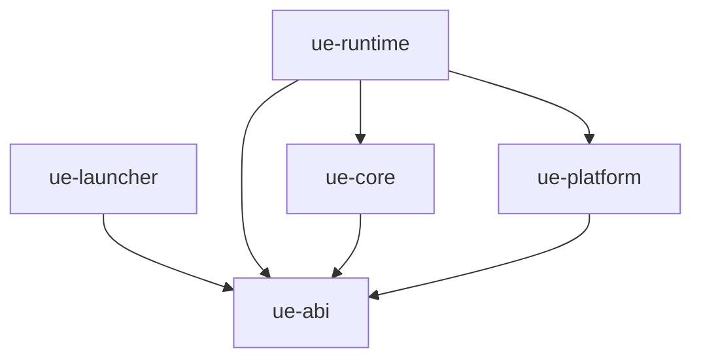

# 자체 Userspace 엔진 코드 구조

2026-10-29. [기본 설계](USERSPACE_ENGINE_DESIGN.md)와
[실행 계약](USERSPACE_ENGINE_EXECUTION.md)을 구현할 파일 경계, 내부 인터페이스,
상태 소유권과 검증 순서로 구체화한다. 아래 경로와 코드 선언은 **전체 구현 명세**다.
실제 workspace에는 초기 네 crate와 entry/ELF loader probe가 있으며, 전체 명세가 구현된 것은
아니다. 현재 코드·검증·설계 조정은 [구현 현황](USERSPACE_ENGINE_IMPLEMENTATION.md)을 따른다.

## 1. 코드 배치와 빌드 경계

엔진 소스는 `native/userspace-engine/`에 독립 Cargo workspace로 둔다.
기존 `guest/droid-*` Cargo 프로젝트나 `tools/direct-linux`를 부모·기반 구현으로
삼지 않는다. Android 제품 연결은
기존 `:android-runtime` 안에 두고 새 RuntimeKind나 Gradle 제품 모듈을 만들지 않는다.

```text
native/userspace-engine/                # 전체 계획; 일부만 구현됨
  Cargo.toml                           # 독립 workspace, product/dev 의존성 분리
  Cargo.lock
  crates/
    ue-abi/src/
      lib.rs                           # 값 타입, 한정된 wire/ASM 경계
      syscall.rs                       # RawSyscall, RawReturn, GuestAddr
      handoff.rs                       # 헤더, offset/길이 검사, FD 역할
      features.rs                      # ABI revision, 요구/관찰 기능
    ue-core/src/
      lib.rs
      dispatch/{mod.rs,table.rs,step.rs}
      ops/{fd.rs,path.rs,process.rs,signal.rs,memory.rs,identity.rs}
      task/{mod.rs,clone.rs,exec.rs}
      fd/{mod.rs,table.rs,description.rs}
      vfs/{mod.rs,walk.rs,namespace.rs,metadata.rs,journal.rs,external.rs}
      vm/{mod.rs,map.rs,patch.rs}
      elf/{mod.rs,parse.rs,plan.rs,stack.rs}
      signal/{mod.rs,delivery.rs,restart.rs}
    ue-platform/src/
      lib.rs
      aarch64/{gate.S,context.rs,cache.rs}
      linux/{syscall.rs,copy.rs,mapping.rs,filter.rs}
    ue-runtime/src/
      lib.rs
      bin/bootstrap.rs                 # freestanding _start, exec 후 재진입
      entry/{svc.S,sigsys.rs,restore.S}
      state/{registry.rs,frames.rs,objects.rs,arena.rs}
      runner.rs                        # core 결정 ↔ 실제 platform 연산
      loader.rs                        # ELF plan을 실제 mapping으로 적용
      patch.rs                         # PatchPlan 검증·공개·회수
      exec.rs                          # handoff FD, commit, bootstrap 재구성
      lifecycle.rs                     # clone/exit, task 등록·회수
      telemetry.rs                     # bounded counter, 실행 계측
    ue-launcher/src/
      main.rs                          # APK host 입력 검증, 초기 bootstrap exec
      probe.rs
      manifest.rs
  spec/
    syscalls.toml                      # 번호/포인터/효과/테스트의 단일 명세
    abi.toml                           # 버전·고정 layout·한도
  link/aarch64/                        # G0에서 검증할 linker script·gate 계약
  tests/{model,fixtures,differential}/
  xtask/src/main.rs                    # host 전용 생성·ABI/ELF 검사
tools/userspace-engine/                # 제안하는 재현 가능한 빌드·측정 진입점
```

파일별 Rust module은 책임 경계이며 모두 별도 crate로 만들지 않는다. 첫 구현에는
G0에서 실제로 사용하는 파일만 추가한다. 일반 파일 데이터·커널 FD를 중계하는
상주 서버, syscall별 plugin, 동적 backend registry는 두지 않는다.

| crate | 직접 product 의존성 | 실행 위치·제약 |
| --- | --- | --- |
| `ue-abi` | 없음 | `no_std`, 고정 정수·ID·codec, allocator 없음 |
| `ue-core` | `ue-abi` | `no_std`, 의미 모델·계획·상태 전이; raw syscall/JNI 없음 |
| `ue-platform` | `ue-abi` | `no_std`, ARM64/Linux의 작은 unsafe 경계; guest 의미 판단 없음 |
| `ue-runtime` | `ue-abi`, `ue-core`, `ue-platform` | `no_std`, 실제 객체 저장·실행·entry/restore 조립 |
| `ue-launcher` | `ue-abi` | Android/Bionic host 프로그램; guest 진입 전에 종료되는 이미지 |

`xtask`와 host test harness만 별도 개발 의존성을 갖는다. launcher의 `std`/Bionic
의존성이 runtime dependency graph로 들어오지 않게 한다. core의 `alloc` 사용은
초기화·명시적인 느린 경로에 한정하고, signal entry와 정상 FD I/O 경로에는 일반
heap 할당을 요구하지 않는다. 전체 엔진을 generic trait 묶음으로 추상화하지 않는다.
core가 반환한 명시적 연산을 runner가 실행하므로 model test는 kernel event를 주입한다.



화살표는 컴파일 의존성이다. launcher → bootstrap은 별도의 exec 관계다.
첫 패키징 후보는 launcher ELF와 core를 정적으로 포함한 bootstrap ELF 두 개다.
bootstrap의 고정 gate·재배치·ASLR이 G0를 통과하지 않으면 artifact 배치를 다시
결정한다. crate 수를 ELF 수나 상주 프로세스 수로 해석하지 않는다.

## 2. ABI와 내부 타입

`ue-abi`에 들어가는 타입은 실행 경계를 실제로 건너는 것만이다. VFS와 task의
구현 객체 전체를 공용 ABI로 공개하지 않는다. 아래 Rust는 인터페이스 발췌이며
참조 타입의 정의나 함수 본문을 포함하는 컴파일 가능한 파일이 아니다.

```rust
// ue-abi: raw Linux ABI와 guest 주소는 host Rust 참조와 구분한다.
#[repr(C)]
pub struct RawSyscall {
    pub nr: u64,
    pub args: [u64; 6],
    pub guest_pc: u64,
    pub guest_sp: u64,
}
#[repr(transparent)]
pub struct RawReturn(pub i64);          // 성공값 또는 음수 errno
pub struct GuestAddr<T> { /* address + PhantomData; 직접 deref 불가 */ }

// ue-core: 실제 저장 위치가 아닌 세대가 있는 ID.
pub struct TaskId { pub tid: u32, pub generation: u64 }
pub struct FrameId { pub task: TaskId, pub slot: u32, pub generation: u64 }
pub struct ObjectHandle { pub index: u32, pub generation: u64 }

// ue-runtime: Copy/Clone 불가. scratch와 in-flight 효과의 소유 토큰.
pub struct ActiveFrame { /* FrameId, frame pool token; guest stack 비의존 */ }
```

RawSyscall은 전체 register save 영역이 아니다. `entry`는 x0–x30/SP/PC/PSTATE와
필요한 확장 register 상태를 별도 `RegisterImage`에 보존한다. FPSIMD/SVE 등의
가변 길이 signal record는 길이·정렬·종류를 검사하고 고정 작은 배열로 잘라 버리지
않는다. 빠른 wrapper가 더 적은 register만 저장하려면 그 wrapper의 증명이 필요하다.

ASM 공유 layout만 `repr(C)`와 명시적인 정수 폭을 사용하고, offset/size/alignment
assertion을 ASM·Rust 양쪽 빌드에서 대조한다. Rust enum의 메모리 layout이나
`usize`를 handoff/file ABI로 사용하지 않는다. wire codec은 고정 endian, 길이 제한,
overflow 검사를 수행하고 알 수 없는 필수 필드를 거부한다. launcher/bootstrap의
ABI revision이 다른 상태에서 일부 구조체만 우연히 맞는 것으로 시작하지 않는다.

| 표현 | 수명과 유효성 |
| --- | --- |
| `GuestAddr<T>` / `GuestSlice` | 숫자 주소; copy 시점마다 검증, 여러 thread의 변경 가능 |
| `PinnedImage` / `PinnedDirectory` | 내부 FD와 identity를 소유; 경로 문자열로 다시 열지 않음 |
| `ObjectHandle` / `MappingId` | 객체 ID+세대; 다른 프로세스에서 포인터로 해석하지 않음 |
| `FdEntry` | guest 번호·CLOEXEC·세대, OpenDescription 참조 |
| `OpenDescription` | 가상 identity와 공유 수명; 실제 파일 offset/status flags의 원본은 kernel OFD |
| `ExecHandoff` | 길이가 제한된 데이터+역할별 FD 목록; Rust 포인터·lock guard·host 비밀 없음 |

실제 FD의 offset을 소프트웨어 복제본으로 계속 갱신하지 않는다. `dup`/fork/FD 전달의
공유는 kernel OFD를 사용하고, 가상 상태가 필요한 부분만 자체 객체에 기록한다.

## 3. 공통 dispatcher와 부작용 실행

진입 adapter는 syscall 의미를 구현하지 않는다. 직접 연결과 SIGSYS 양쪽에서
`RawSyscall + RegisterImage + TaskId`를 만들고 같은 `runner::dispatch`로 들어간다.
`ops/path.rs` 등에 있는 구현이 어떤 진입 방식인지에 따라 errno를 바꾸면 결함이다.

```rust
// ue-core::dispatch: 한 번의 step은 외부 I/O나 guest callback을 호출하지 않는다.
pub enum Decision {
    Issue(EffectRequest),              // frame이 소유하는 host 연산 요청
    Return(RawReturn),
    Transition(LifecycleRequest),      // clone/exec/sigreturn/exit 전용 경로
}
pub struct EffectRequest {
    pub id: EffectId,                  // FrameId + frame 내부 sequence
    pub op: HostOp,
    pub completion: CompletionPolicy, // 부분 완료·errno·재시작 명세
}
pub enum StepInput {
    Enter(RawSyscall),
    Completed(EffectCompletion),
    Interrupted(Interruption),
}
pub fn step(state: &mut ShortStateView<'_>, input: StepInput)
    -> Result<Decision, EngineFault>;
```

`ShortStateView`는 조회/갱신 범위에만 존재하며 `Decision`에 빌린 참조를 넣지 않는다.
runner는 상태 접근을 끝낸 뒤 host 연산을 수행하고, 결과를 ID로 다시 연결한다.
이 구조는 syscall마다 heap 객체나 IPC를 만든다는 뜻이 아니다. 작은 enum과
frame scratch를 사용하고 일반 FD read/write는 검증 뒤 한 번의 host 호출로 끝낸다.

```text
entry → frame 확보 → core.step(Enter)
                       │
                  Issue(EffectId)
                       ↓
       상태 borrow/guard 종료 → platform 호출
                       ↓
       frame에 결과 기록 → core.step(Completed)
                       ↓
                 Return / 다음 Issue / 수명 전이
                       ↓
                 register 복구 → guest
```

EffectId는 중복 completion 적용을 막는 식별자다. host kernel의 부작용을
원자화하거나 crash 후 exactly-once 실행을 보장하는 토큰이 아니다. `Issued` 뒤
결과가 불확실하면 syscall별 확인/복구 규칙을 따르며 전체 요청을 다시 실행하지 않는다.
`close`, 부분 `write`, `rename`, `exec`에 공통 retry loop를 적용하지 않는다.
`rt_sigreturn`과 성공한 exec/exit는 보통 함수 반환으로 처리하지 않는다.

`EngineFault`와 guest errno도 분리한다. 잘못된 guest 포인터는 명세에 맞는 EFAULT,
잘못된 ELF는 해당 실행 오류, 내부 불변식 손상은 현재 실행의 engine failure다.
내부 오류를 임의 ENOSYS로 바꾸거나 panic으로 guest stack을 unwind하지 않는다.

### 3.1 syscall 명세의 최소 행

`spec/syscalls.toml`은 번호/dispatch/필터 정책/지원표의 공통 입력이다. semantic
함수 본문까지 생성하지 않는다. `xtask`는 번호 중복, 누락된 handler/test ID,
잘못된 feature 참조를 검사한다. 빌드하지 않은 syscall을 지원표에 싣지 않는다.

```toml
[[syscall]]
arch = "aarch64"
name = "openat"
number = 56
class = "translated"
handler = "ops::path::openat"
arguments = ["dirfd", "path_in_nul", "flags", "mode"]
state = ["fs", "fd_table", "namespace"]
effects = ["path_lookup", "possible_create", "fd_install"]
restart = "operation_specific"
tests = ["path_openat", "fd_emfile", "openat_interrupt", "shared_lookup"]
```

필터는 runtime FD registry를 볼 수 없으므로 명세의 `class`만 보고 read/write를
항상 ALLOW하지 않는다. 초기 FD 호출은 내부 dispatcher가 종류를 확인한다.
직행은 상태 의존성과 내부 FD 접근이 없음을 증명한 규칙만 허용한다. 미지 번호의
동작도 table의 명시적인 정책으로 정하고 무조건 host로 전달하지 않는다.

## 4. 상태 소유권과 재진입

`ue-core`는 상태 값과 전이 규칙을 정의하고, `ue-runtime::state`가 실제 저장 공간,
동기화, task 조회와 수명을 소유한다. 전역 `&mut Engine`을 얻은 채 syscall을
실행하거나 guest handler를 호출하는 API는 금지한다. 같은 thread의 signal
재진입도 Rust aliasing 관점에서는 별개의 접근이기 때문이다.

| 객체 | 범위 | 소유·공유 규칙 |
| --- | --- | --- |
| `EnvironmentStore` | 동일 Environment의 프로세스들 | metadata/journal의 process-shared 조정, 다른 Environment와 분리 |
| `VmSpace` | `CLONE_VM` 공유 집합 | mapping·patch 세대·engine 영역, fork 시 COW 및 child 재등록 |
| `FdTable` | `CLONE_FILES` 공유 집합 | FD install/close/reuse의 세대·예약, exec의 unshare 반영 |
| `FsContext` | `CLONE_FS` 공유 집합 | cwd/root/umask, 경로 pin 수명 |
| `SignalActions` | `CLONE_SIGHAND` 공유 집합 | guest disposition; per-thread mask/altstack과 분리 |
| `TaskState` | kernel task | 위 공유 객체의 handle, credential·exec 세대·guest mask |
| `FramePool` | task의 중첩 진입 | register/scratch/진행 중 효과; TID 재사용 전에 회수 |

공유 객체의 backing과 recovery는 process-shared arena/메타데이터 저장소에 둔다.
다른 주소 공간으로 넘기는 참조는 ID/offset이다. 일반 `Arc`나 PID 단위 map 하나로
`CLONE_FILES`만 공유하는 서로 다른 프로세스를 구현했다고 보지 않는다. clone flag
유효성은 커널 의미에 맞게 검사하고 parent/child 복귀 전에 공유 관계를 확정한다.
실행 계약의 `ProcessContext`는 이 공유 객체 묶음의 논리적인 view이며, 모든 thread의
VM/FD/FS를 하나의 PID 소유 객체에 합치는 구조가 아니다.

`TaskRegistry`는 gate의 gettid와 generation으로 찾는 초기 후보다. signal lookup은
할당·blocking lock 없이 수행하고 table 재배치 중 오래된 entry를 읽지 않게 한다.
예약한 child slot은 clone 실패 시 회수하며, child는 guest 복귀 전에 자기 slot을
publish한다. vfork child는 parent의 일반 allocator/lock을 사용하지 않는다.

상태 guard는 외부 I/O, guest-memory 접근, fault 가능 연산, guest callback을 가로질러
유지하지 않는다. 작은 갱신 뒤 snapshot/세대/예약을 반환하고 완료 시 재검증한다.
namespace mutation의 reservation은 lock guard와 구분한다. journal·host mutation
사이에 신호가 오면 진행 중 효과를 먼저 판정해 안전한 delivery 지점으로 이동한다.
동일 task의 nested 호출이 중단된 자기 작업의 lock을 기다리게 해서는 안 된다.
이 delivery/복구 절차가 성립하지 않으면 해당 mutation은 G2 미완료다.

frame의 lifetime은 Rust stack unwinding에 맡기지 않는다. longjmp/setcontext와
signal frame 탈출을 감지·조정하는 `signal::delivery`와 runtime frame registry가
정리할 소유 자원을 기록한다. 정상 `Drop`은 보조 수단이며 유일한 회수 경로가 아니다.
탈출 감지가 안 되는 경로에서 누수 없는 지원을 선언하지 않는다.

## 5. 주요 연산의 코드 흐름

### 5.1 openat와 일반 파일 I/O

1. `entry`가 RawSyscall을 캡처하고 `dispatch/table`이 `ops::path::openat`를 선택한다.
2. `vfs/walk`는 root/cwd/dirfd snapshot과 syscall별 final-component 규칙으로
   guest 경로를 해석한다. 경로 copy와 host directory lookup은 각각 EffectRequest다.
3. `vfs/namespace`가 일반·가상 hardlink·외부 공유 backing을 결정한다.
   O_CREAT 등 mutation은 `vfs/journal`의 예약/복구 규칙을 적용한다.
4. `runner`가 `ue-platform`을 통해 host open을 실행한다. FIFO 등 blocking open을
   namespace lock을 쥔 채 기다리지 않는다. signal/restart는 frame 상태로 되돌린다.
5. `fd/table`에 반환 FD와 OpenDescription을 publish한 뒤 guest에 숫자를 반환한다.
   열린 FD의 등록 실패는 leak 없이 정리하지만 이미 발생한 파일 생성까지 없던 일로
   취급하지 않는다. guest에 보일 FD 번호를 임의로 바꾸지 않는다.
6. 후속 read/write는 `ops/fd`의 분류를 거쳐 실제 FD와 page cache를 사용한다.
   전체 버퍼를 먼저 복사해 partial I/O나 EFAULT의 관찰 시점을 바꾸지 않는다.

`vfs/external`은 공유 폴더의 외부 변경을 고려한다. engine-managed rootfs의 journal
규칙을 외부 writer에 강제할 수 있다고 가정하지 않는다. `/proc` 등 가상 파일과
socket pathname은 같은 path 객체를 사용하되 각 syscall의 결과 변환을 명시한다.

### 5.2 ELF 적재와 syscall 직접 연결

`elf/parse`는 제한된 byte reader로 ELF를 검증하고 `elf/plan`은 순수 LoadPlan을
만든다. 실제 mmap/mprotect는 runtime loader가 수행한다. guest PT_INTERP를 적재해
제어를 넘기며, guest 동적 링커의 relocation/TLS 처리를 새 링커로 대체하지 않는다.

`vm/patch`는 image identity, 원본 명령, control-flow와 register 규약을 검증해
PatchPlan을 만든다. runtime patcher만 W^X 변경과 cache synchronization을 수행한다.
entry assembly는 plan이 요구하는 규약만 구현한다. 아직 실행하지 않는 image의
검증된 wrapper부터 연결하고, 실행 중인 DSO/JIT는 초기에는 TRAP으로 처리한다.

`MappingId + generation`을 통해 plan을 무효화하고 active frame이 참조하는 relay와
PC map은 retirement 이후에도 마지막 참조까지 유지한다. cache 압박이 살아 있는
분기 대상을 해제하는 이유가 될 수 없다. RWX나 `/proc/self/mem` 대체 경로는 없다.

### 5.3 exec와 bootstrap

`task/exec`가 reset/preserve 결정을, `elf`가 image 검증을, runtime exec가 FD/handoff
전송과 실제 kernel commit을 담당한다. `ExecPlan`은 commit 전 상태이고 wire
`ExecHandoff`와 구분한다. argv/env의 snapshot과 image/interpreter pin은 전송 전에
완료하며 guest가 실행 파일 이름을 바꾸어도 다시 이름으로 조회하지 않는다.

```text
guest exec → core ExecPlan → runtime handoff 봉인·필요 FD 준비
  → 고정 APK bootstrap으로 kernel exec
      실패: 준비 자원 회수, 원래 guest에 errno
      성공: _start → ABI/FD 검증 → registry 재구성 → image 적재
            → handler/gate 상태 확인 → guest entry
```

bootstrap은 libc 초기화나 새 필터 설치에 의존하여 상속 필터를 통과하지 않는다.
handler 준비 전 syscall부터 기존 gate 계약이 성립해야 한다. 반복 exec에서 필터를
누적하지 않는다. 고정 gate가 bootstrap의 첫 syscall 이전에 어떻게 존재하는지는
`link/aarch64`의 G0 검증 사항이며 아직 주소나 linker script를 확정하지 않는다.
초기 launcher만 자체 엔진 필터를 아직 설치하지 않은 최초 진입을 준비한다.
Android의 상속 필터는 이때도 적용된다. guest exec는 Bionic launcher를 경유하지
않는다. commit 후 실패는 실제 프로세스 종료로 보고한다.

## 6. Android 제품 연결

현재 [RootlessSessionController](../android-runtime/src/main/kotlin/dev/terminal/runtime/rootless/RootlessSessionController.kt)는
PRoot용 launch spec을 만들고 PTY를 소유한다.
[RootlessEnvironmentSetup](../android-runtime/src/main/kotlin/dev/terminal/runtime/rootless/RootlessEnvironmentSetup.kt)과
[RootlessNssCache](../android-runtime/src/main/kotlin/dev/terminal/runtime/rootless/RootlessNssCache.kt)도
같은 spec과 PRoot 고유 옵션을 사용한다. 세션 시작 하나만 바꾸면 설치·보조 명령이
다른 엔진으로 실행되는 불일치가 생기므로 아래 연결을 하나의 G4 작업으로 다룬다.

제안 패키지는 `dev.terminal.runtime.rootless.engine`이다.

```kotlin
// 제안 인터페이스. 실제 클래스나 공개 Binder API가 아니다.
internal interface UserspaceEngine {
    val descriptor: EngineDescriptor
    fun prepare(
        request: GuestLaunchRequest,
        context: EngineLaunchContext,
    ): Result<PreparedLaunch>
}

internal data class GuestLaunchRequest(
    val argv: List<String>,
    val environment: Map<String, String>,
    val cwd: String,
    val purpose: LaunchPurpose, // Interactive / Maintenance / Helper
)

internal interface PreparedLaunch : AutoCloseable {
    val spec: HostLaunchSpec     // APK command, host env, 명시적인 FD mapping
    fun onSpawned(child: ChildIdentity): RunningLaunchResources
}
```

`EngineLaunchContext`는 host가 선택한 Environment/storage identity, engine revision,
DNS·공유 디렉터리 pin·허용된 guest capability endpoint를 가진다. guest env나 shell
인자로 engine 선택·host bind·내부 FD를 지정하지 못한다. guest가 이미 허용받은
capability와 host service의 비밀/권한을 구분하며 후자를 guest core에 넘기지 않는다.

`PreparedLaunch`는 시작 전 manifest/pin 자원을 소유한다. spawn 실패 시 close로
회수하고, 성공 시 child identity와 연결된 `RunningLaunchResources`로 소유권을
옮긴다. UI detach는 어느 쪽의 close 조건도 아니다. controller/명령 owner가 실제
종료·실패·명시적 취소 때 회수한다. engine 선택은 Environment가 살아 있는 동안
고정하며 launch 실패에 따라 PRoot를 자동 선택하지 않는다.

| 제안 파일 / 기존 연결점 | 책임 |
| --- | --- |
| `engine/UserspaceEngine.kt`, `GuestLaunchRequest.kt` | 공통 입력·진단·resource lease 계약 |
| `engine/ProotEngineAdapter.kt` | 기존 launch spec·가속·NSS·maintenance 종료 정책을 보존 |
| `engine/IndependentEngineAdapter.kt` | APK artifact 확인, 기능/저장 형식 검사, manifest와 FD 계획 |
| `engine/EngineManifestCodec.kt` | wire codec·한도, native parser와 golden vector 대조 |
| `RootlessDebianBackend` | 같은 engine instance를 setup/controller/helper에 주입 |
| `RootlessSessionController` | prepare 결과로 PTY 시작, 출력·resize·detach·종료 소유권 유지 |
| `RootlessEnvironmentSetup`, `RootlessNssCache` | 동일 engine의 Maintenance/Helper 실행; PRoot 옵션 밖으로 이동 |
| `RootlessEngineInfo`, `NativeExecutableLoader` | 실제 engine/ABI/capability 진단, 고정 APK 이름 검증 |
| 저장 형식·설치·백업 adapter | engine ID와 storage version 독립 검사, 새 Environment로 변환 |

기존 PRoot adapter는 비교와 기존 Environment 운영을 위한 연결이다. 새 engine의
crate·syscall·저장 형식은 이 adapter나 PRoot 코드를 import하지 않는다.

### 6.1 FD 전달과 자식 수명은 별도 구현 항목

현재 [PTY native 생성 코드](../terminal-emulator/src/main/jni/terminal-jni.c)는
자식에서 0/1/2 외의 FD를 닫는다. 현재 `PtyProcess.start`에는 FD 상속 목록이 없고
setup의 Java ProcessBuilder 경로에도 이 계약이 없다. 기존 API에 FD 번호만 써서
manifest 전달이 구현된 것처럼 취급하지 않는다.

G4에서는 process facade 아래에 엔진 중립 `SpawnFdMapping(source, childTarget)`을
추가하고 PTY·pipe 명령 실행 양쪽이 사용하도록 한다. parent FD는 spawn 완료까지
pin하고 child 안에서 충돌 없는 순서로 duplicate/remap한다. 0/1/2 충돌·중복 target·
RLIMIT를 검사하고 allow-list 외 FD는 닫는다. error-report FD는 launch 성공/실패
판정까지 유지하고 CLOEXEC 및 parent 정리 규칙을 검증한다. guest argv/env의 숫자는
이 목록을 확장할 수 없다. renderer나 terminal session protocol에 엔진 필드를 넣지 않는다.

launch handshake와 진단 channel은 시작/종료용이며 syscall별 요청 channel이 아니다.
interactive launcher는 bootstrap으로 exec해 PTY owner가 관찰하는 PID를 유지하는
방향으로 설계한다. maintenance의 PRoot EXITKILL/kill-on-exit 효과는 새 engine에서
자동으로 생기지 않는다. `lifecycle`의 task 등록과 owner의 command-scope 종료 정책을
연결하고 daemonize/setsid한 후손까지 취소 범위·회수 가능성을 검증한다. PID 재사용,
owner 사망, 동시에 실행 중인 다른 Environment의 보호를 통과하기 전에는 현재의
패키지 취소와 동등하다고 선언하지 않는다. 새 상주 syscall broker로 해결하지 않는다.

## 7. 구현 단위와 통과 기준

단계별 파일은 해당 동작과 검증을 함께 추가한다. 문서의 전체 디렉터리를 빈 crate나
ENOSYS 함수로 먼저 생성하지 않는다. G0 이전에 새 엔진을 제품 기본값으로 선택하지 않는다.

| 순서 | 구현 단위 | 관련 검사와 다음 단계 조건 |
| --- | --- | --- |
| S0 | `ue-abi`, `ue-platform`, 작은 bootstrap fixture, 명세 검사기 | layout/codec 경계, artifact의 TLS·libc 의존성·gate 확인; guest 로딩 전 기반 확보 |
| S1 | `entry`, frame registry, core step, 최소 dispatcher | E01/E02/E04/E05/E06: raw/직접 연결/TRAP 결과·register·재진입·filter 의미 |
| S2 | ELF plan/loader, exec handoff, 초기 patch publisher | E03/E07/E08: exec 1,000회, W^X 실패, 4/16 KiB 및 실제 ELF; G0 성립 판정 |
| S3 | task/FD/VM 공유, signal/clone/exec 통합 | G1: clone flag 조합, vfork/nonleader exec, FD 재사용·취소·중첩 signal |
| S4 | VFS/namespace/metadata/journal/external | G2: hardlink·disk-full·crash·다중 process와 실제 패키지 결과 |
| S5 | 직접 연결 확대·계측·메모리 회수 | G3: 동일 fixture 성능·총 CPU/PSS, 연결률과 TRAP 비용 분리 |
| S6 | Kotlin engine adapter, FD spawn, 설치·백업·진단 연결 | G4: 기존 PRoot 보존, engine 일관성·수명·취소·새 환경 이행 |

S1/S2는 필요한 syscall과 작은 상태 모델로 진입 구조를 증명하며 G1 전체 구현을
미리 요구하지 않는다. E03의 nonleader exec 등은 최소 thread fixture로 시험한다.
native probe는 전용 test APK에서 실제 app UID·target SDK·enforcing 조건으로
실행한다. 기존 Direct Linux/PRoot probe의 성공을 이 검증으로 대체하지 않는다.

검증 위치와 역할은 다음과 같다.

- `tests/model`: clone 공유·FD 세대·exec 실패·namespace 전이의 deterministic 검사.
  fake kernel은 순서와 오류를 주입하는 용도이며 Linux 호환성 증명이 아니다.
- `tests/fixtures`: 직접 syscall·register/signal·고의 fault·동적 x8·비표준 SP를 가진
  독립 ARM64 프로그램. 일부는 assembly로 compiler의 호출 규약 가정을 제거한다.
- `tests/differential`: 같은 payload를 직접 실행/연결/TRAP과 비교하고 결과·부작용을
  대조한다. device/배포판/페이지/필터/fixture hash를 함께 기록한다.
- `xtask`: 명세 완전성, 의존성, ASM offset, ELF DT_NEEDED/TLS·gate 범위, W^X 검사.
  실제 gate 호출·정책 성공과 runtime 무추적 검사는 device 결과가 필요하다.
- Android module tests: launch 입력·FD 소유권·manifest 양쪽 codec·실패 회수 검사.
  G4 코드 변경 시 저장소 canonical Gradle 검증과 기기 수명 검사를 실행한다.

## 8. 비용을 제한할 코드 규칙과 남은 결정

정상 syscall 경로에는 문자열 로그, JSON codec, JVM callback, channel 전송,
전역 Environment mutex와 heap 할당을 넣지 않는다. 계측은 frame/task의 bounded
counter로 시작하고 측정 모드에서만 집계한다. 모든 thread가 경쟁하는 카운터의
atomic 증가를 필수 비용으로 만들지 않는다. 재진입 counter도 data race가 없어야 한다.

stack·scratch·frame depth·path cache·code cache·shared arena마다 사용량과 상한을
측정한다. 고갈은 명시적인 실패/안전한 느린 경로이며 register나 경로를 잘라 내는
이유가 될 수 없다. 기본 설계의 프로세스·thread 메모리 예산은 목표로 유지하되
vector state와 nested signal 비용을 측정하기 전에 고정 크기 allocator로 확정하지 않는다.

다음 결정은 파일 구조와 구분하여 열린 상태로 둔다.

| 미확정 항목 | 결정 위치와 필요한 증거 |
| --- | --- |
| 고정 gate 주소·ELF 형태·relocation | S0/S2, 첫 syscall 및 exec 후 상속 필터 아래 실행 |
| guest pointer copy 수단·signal 중 안전한 state 접근 | S1, EFAULT/진짜 fault·nested handler·longjmp 검사 |
| syscall 연결 wrapper 범위 | S1/S5, register/SP/BTI/PAC 보존과 실제 비용 절감 |
| metadata wire layout·journal durability | S4 시작 전 encoding freeze, crash/ENOSPC/fsync 검증 |
| maintenance 후손 종료와 owner 사망 회수 | S3/S6, daemonize·PID 재사용·다른 Environment 격리 |
| 정확한 Rust target/link 옵션·의존성 버전 | S0, ARM64 host 재현 빌드와 freestanding artifact 검사 |

이들 항목이 이름 있는 모듈로 배치됐다는 사실은 문제가 해결됐다는 뜻이 아니다.
성립하지 않는 진입·신호·exec 계약은 구조 재설계 사유이며, ptrace fallback이나
명령별 성공 위장으로 통과시키지 않는다.
