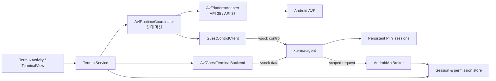

# AVF 터미널 참조 APK 분석 및 통합 설계

## 1. 결론

`tmp/VmTerminalApp.apk`를 프로젝트에 라이브러리나 코드 형태로 직접 이식하지 않는다.
이 APK는 Android 17(API 37) 플랫폼 빌드의 `VmTerminalApp`이며, 일반 Gradle 앱에서 사용할 수
없는 platform API, privileged 권한, 내부 AIDL과 Samsung 플랫폼 서명에 의존한다.

대신 다음처럼 역할을 나눈다.

- Android 쪽 화면과 터미널 에뮬레이터는 기존 Termux 구현을 유지한다.
- 데이터 경로는 기존 `VirtualMachine.connectVsock()` + `xtermx-agent` 영속 PTY 프로토콜을
  유지한다.
- 참조 APK에서 검증된 VM 상태 관리, 포그라운드 서비스, 제한 시간 wake lock, 포트 승인,
  공유 경로, 이미지 업데이트/복구 패턴만 다시 설계해 반영한다.
- API 35의 최소 기능을 기준선으로 삼고 API 37 기능은 런타임 capability로 선택한다.
- 플랫폼 서명을 전제로 하는 기능과 일반 개발자 옵션 환경에서 가능한 기능을 빌드/런타임
  경계에서 분리한다.

이 방향은 참조 앱을 복제하는 것보다 프로젝트 목표에 더 잘 맞는다. 참조 앱의 ttyd/WebView
터미널은 연결이 끊기면 탭 상태도 함께 약해지는 반면, 현재 프로젝트의 게스트 PTY는 Android
Activity와 전송 연결이 끊겨도 VM이 살아 있는 동안 세션을 다시 attach하고 누락 출력을 재생할
수 있기 때문이다.

## 2. 분석 대상과 재현 정보

| 항목 | 값 |
| --- | --- |
| 파일 | `tmp/VmTerminalApp.apk` |
| SHA-256 | `97dbc58ccbd583fb12449e7ebc9e3aaf2a3ced33a60ddace84752fe286806ac8` |
| package | `com.android.virtualization.terminal` |
| version | `17` / versionCode `37` |
| min/target/compile SDK | `37` |
| ABI | `arm64-v8a` 전용 |
| 서명 | Samsung 플랫폼 계열 인증서 |
| application | manifest에서 기본 `enabled=false` |
| 주요 asset | `cidata.iso`, ttyd WebView JavaScript |
| native library | `libforwarder_host_jni.so` |

`enabled=false`인 것은 Developer Options가 패키지 활성 상태를 제어하는 시스템 앱 배포 방식을
뜻한다. 일반 설치 APK가 이 동작을 그대로 재현하려고 해서는 안 된다.

정적 분석은 manifest/resource/DEX/native library/cidata ISO를 대상으로 수행했다. 디컴파일
결과 일부가 완전하지 않을 수 있으므로, 설계 판단은 가능한 범위에서 공개 AOSP TerminalApp
소스와 대조했다. APK 안의 Samsung 빌드 바이너리나 cidata 바이너리를 프로젝트 산출물로
복사·재배포하지 않는다. 필요한 구현은 Apache-2.0인 AOSP 소스를 기준으로 다시 작성하고
NOTICE를 유지한다.

## 3. 참조 APK 구조

### 3.1 권한과 배포 경계

APK는 다음과 같은 권한/기능을 요구한다.

- `android.software.virtualization_framework`
- `MANAGE_VIRTUAL_MACHINE`
- `USE_CUSTOM_VIRTUAL_MACHINE`
- `MANAGE_EXTERNAL_STORAGE`
- `FOREGROUND_SERVICE_SPECIAL_USE`
- `WAKE_LOCK`, `INTERNET`, `ACCESS_NETWORK_STATE`
- API 37 계열의 로컬 네트워크와 loopback 관련 권한

AOSP의 `Android.bp`도 `platform_apis: true`, `privileged: true`,
`framework-virtualization.impl`, 내부 virtualization service AIDL과 native forwarder에 의존한다.
따라서 동일 APK 기능을 standalone 앱에 그대로 넣는 것은 서명과 빌드 시스템 양쪽에서
성립하지 않는다.

### 3.2 VM 수명주기

참조 앱의 새 구현은 대략 다음 상태를 갖는다.

```text
Ready -> Starting -> Running -> Rebooting
                    |             |
                    +-> Stopping <-+
                           |
                        Stopped

모든 단계 -> Error
```

중요한 동작은 다음과 같다.

- VM 시작 전 전용 foreground service를 먼저 올린다.
- AVF callback과 별도 guest-agent 등록을 이용해 VM 부팅과 게스트 준비를 구분한다.
- 설치 또는 VM이 살아 있는 동안만 foreground service를 유지한다.
- 앱이 백그라운드일 때에만 설정된 시간만큼 partial wake lock을 잡는다.
- 알림에 현재 설치/부팅/실행/종료 상태와 VM 중지 action을 제공한다.
- 실행마다 VM 등록을 다시 만들되 rootfs 같은 외부 disk 데이터는 별도로 관리한다.
- 부팅 제한 시간을 두고 실패를 사용자 상태로 승격한다.

다만 새 UI의 ViewModel 정리 경로가 VM 중지와 연결된 부분도 있어, 이를 그대로 복사하면
Activity/task 수명주기가 VM 수명주기를 다시 끌고 갈 수 있다. 이 프로젝트에서는 VM 소유자를
오직 `TermuxService`로 제한한다.

### 3.3 터미널 데이터 경로

참조 앱은 guest의 ttyd를 WebView에 표시한다.

```text
WebView -> 127.0.0.1 임시 포트 -> cookie 확인 -> AF_VSOCK:7681
                                             -> ttyd Unix socket -> shell
```

구형 이미지에서는 guest IP와 NSD를 사용한다. 새 이미지에서는 native/Java bridge가 loopback
TCP를 AF_VSOCK으로 전달한다. WebView에는 제어 키, 터치, 연결 종료 처리를 위한 JavaScript를
주입한다.

이 방식은 웹 터미널을 빠르게 제공하지만 이 프로젝트에는 불필요한 계층이다.

- 이미 `TerminalView`와 `terminal-emulator`가 있다.
- WebView, JavaScript, loopback proxy, ttyd를 더하면 입력 지연과 장애 지점이 늘어난다.
- 참조 WebView의 SSL 오류 무조건 통과 동작은 보안상 재사용하면 안 된다.
- 참조 앱의 탭 UUID는 주로 메모리에 있고, 현재 프로젝트처럼 PTY 출력 offset을 기준으로
  복원하는 프로토콜이 아니다.

### 3.4 게스트 제어 경로

참조 APK의 cidata는 Linux 안에 root guest agent를 설치한다. 새 구현은 Binder RPC over
vsock으로 Android에 등록하고, 구형 구현은 gRPC를 사용한다. 제어 기능에는 다음이 포함된다.

- 게스트 준비와 종료
- 활성 TCP 포트 보고 및 forwarding
- clipboard
- storage balloon
- display/GPU/audio 보조 기능
- ttyd 구동과 virtiofs mount

Binder RPC는 API 37 플랫폼 내부 AIDL과 함께 배포되는 구현이므로 API 35 baseline의 필수
의존성으로 삼지 않는다. 프로토콜 독립적인 기능 모델만 가져온다.

### 3.5 이미지 설치와 공유 저장소

참조 앱은 큰 Debian 이미지 tarball을 resume 다운로드하고 설치 상태, build id, cidata 호환
버전, 이전 rootfs backup을 관리한다. API 37에서는 shared path를 virtiofs tag로 전달하여
Android 경로를 guest의 `/mnt/shared`에 mount한다.

쓸 만한 패턴은 resume/pause, 여유 공간 검사, rootfs backup, cidata 호환성 확인이다. 반면
현재 프로젝트의 stage 설치, archive SHA-256 고정, 파일별 manifest 검증, 경로 탈출 방지는
참조 APK보다 더 엄격하므로 유지해야 한다.

## 4. 현재 프로젝트의 강점과 간극

### 4.1 이미 갖춘 강점

- `AvfGuestTerminalBackend`
  - vsock port `5580`의 versioned framed protocol
  - UUID 기반 `create_or_attach`
  - 출력 offset replay
  - 전송 단절 시 exponential reconnect
  - `detach`와 shell `terminate`의 의미 분리
- `xtermx_agent.py`
  - 호스트 연결과 독립된 guest PTY
  - 제한된 scrollback 보관
  - resize, exit, Android API 요청 처리
- `AvfImageInstaller`
  - staging 후 active/previous 교체
  - 다운로드 archive의 고정 SHA-256 검증
  - 파일 목록과 파일별 checksum 검증
  - tar entry 수/압축 해제 크기 제한
  - symlink와 특수 tar entry 거부, canonical path 경계 검사
- `TermuxService`
  - Activity가 아니라 service가 VM과 세션 객체를 소유
  - 기존 foreground notification 및 wake lock 기반

이 네 가지는 통합 후에도 중심축으로 남긴다.

### 4.2 우선 해결할 간극

1. `AvfRuntimeManager.startVm()`은 `run()` 반환 직후 성공으로 간주한다. VM running과 guest
   protocol ready가 구분되지 않는다.
2. AVF callback, stop reason, boot timeout이 없어 실패가 terminal backend의 무한 reconnect로
   가려질 수 있다.
3. `close()`와 이미지 교체가 즉시 `VirtualMachine.stop()`을 호출한다. guest flush와 정상
   shutdown 기회가 없다.
4. API 메서드의 존재 여부를 호출 지점마다 선택적으로 무시한다. 플랫폼별 기능 조합과 실패
   원인을 사용자에게 설명하기 어렵다.
5. hidden API bypass가 AVF 진입 전에 명시적으로 초기화되지 않는다.
6. `getOrCreate()`가 이전 config의 VM 등록을 돌려줄 수 있어 이미지/config 세대 교체의 의미가
   모호하다.
7. host의 terminal session UUID/마지막 offset 메타데이터가 프로세스 재생성에 대비해 영속화돼
   있지 않다.
8. 수동 import archive는 사용자가 골랐다는 이유로 publisher authenticity를 검증하지 않는다.
   archive 내부의 자기 선언적 파일 hash는 변조 일관성만 검증한다.
9. Android API broker의 전체 shared storage 접근은 사용자별 grant보다 넓다.
10. 설치 resume, metered network 정책, pause/cancel, guest data disk 분리가 없다.

## 5. 목표 아키텍처



### 5.1 `AvfPlatformAdapter`

리플렉션을 한 파일에 더 쌓지 않고, 플랫폼 API 차이를 adapter 뒤에 감춘다.

```java
interface AvfPlatformAdapter {
    AvfCapabilities probe(Context context);
    VmHandle createOrReplace(VmSpec spec, VmEvents events);
    VmStatus status(VmHandle vm);
    ParcelFileDescriptor connectVsock(VmHandle vm, long port);
    void requestHardStop(VmHandle vm);
    void deleteRegistration(String name);
}
```

`AvfCapabilities`는 최소한 아래를 독립된 값으로 제공한다.

- custom VM / network / callback / vsock
- shared path(virtiofs)
- Binder guest service 연결
- display / GPU / input / audio
- auto memory balloon
- 플랫폼 버전과 실제 발견된 method signature

구현은 `Api35PlatformAdapter`와 `Api37PlatformAdapter`로 나누되, SDK 숫자만 믿지 않고 method
probe 결과를 함께 사용한다. OEM backport와 vendor 변형을 흡수하기 위해서다. hidden API
bypass는 `TermuxApplication.onCreate()`에서 AVF 지원 빌드일 때 한 번 초기화하고, 실패는
`UNSUPPORTED_API_ACCESS` 진단으로 노출한다.

### 5.2 `AvfRuntimeCoordinator`

`TermuxService`가 단일 instance를 소유하고 모든 상태 변경을 전용 single-thread executor에서
직렬화한다.

```text
Unsupported / PermissionRequired / ImageRequired
                    |
                 Stopped
                    |
                 Starting --(VM callback running)--> GuestStarting
                    |                                  |
                    +---------- timeout/error ---------+
                                                       |
                                            GuestReady / Running
                                               |          |
                                     TransportLost    Stopping
                                               |          |
                                           Reconnecting  Stopped
```

규칙은 다음과 같다.

- `run()` 성공은 `GuestStarting`일 뿐 `Running`이 아니다.
- control port의 version/capability handshake가 끝나야 `GuestReady`다.
- 터미널 transport 단절은 VM failure와 구분해 `Reconnecting`으로 처리한다.
- AVF callback의 stop reason을 구조화해 setup 화면과 로그에 남긴다.
- 부팅 timeout 기본값을 설정하고 device/emulator profile로 조정한다.
- Activity 종료는 VM을 멈추지 않는다.
- 사용자 중지, 명시적 service 종료, 이미지 교체만 shutdown을 시작한다.
- 종료는 guest `SHUTDOWN` RPC -> 제한 시간 대기 -> `VirtualMachine.stop()` 순서다.
- 이미지 세대가 바뀌면 VM registration을 versioned name으로 만들거나 명시적으로 삭제 후
  생성한다. writable data disk는 registration과 분리한다.

`VirtualMachine.stop()`은 정상 OS shutdown이 아니라 마지막 수단인 hard stop으로 취급한다.

### 5.3 Foreground service와 백그라운드 정책

새로운 별도 VM service를 만들지 않고 `TermuxService`를 단일 foreground owner로 유지한다.
서비스가 둘이면 사용자 중지, 세션 수명, 알림의 책임이 갈린다.

- notification에 `설치 중`, `부팅 중`, `게스트 준비 중`, `실행 중`, `재연결 중`, `종료 중`을
  표시한다.
- 알림 action으로 `VM 종료`를 제공한다.
- `keep awake`는 무기한 boolean 대신 `사용 안 함 / 30분 / 2시간 / 화면이 꺼진 동안` 같은
  만료 시각으로 저장한다.
- partial wake lock은 앱이 background인 동안에만 잡고 timeout을 반드시 지정한다.
- Wi-Fi lock은 실제 guest 네트워크 작업이 있을 때만 별도로 판단한다.
- 저메모리 callback은 가능하면 AVF memory trim/balloon으로 전달한다.
- Android 프로세스 자체가 강제 종료된 뒤에도 guest process가 계속된다고 약속하지 않는다.
  보장 범위는 Activity 재생성과 transport 단절 동안의 세션 유지다.

### 5.4 프로토콜 v3: control plane과 data plane 분리

현재 v2 데이터 프레임과 attach 의미는 유지하고, handshake에서 v2 fallback을 허용한다.

Control connection의 제안 메시지:

- `HELLO(min_version, max_version, host_nonce, auth)`
- `WELCOME(version, guest_build, capabilities, boot_id)`
- `HEALTH`
- `LIST_SESSIONS`
- `SHUTDOWN(deadline_ms)`
- `ACTIVE_PORTS_SUBSCRIBE`
- `PORTS_CHANGED`
- `STORAGE_BALLOON_SET`
- `CLIPBOARD_OFFER` / `CLIPBOARD_REQUEST`

Terminal data connection의 기존 메시지:

- `CREATE_OR_ATTACH(session_id, cwd, rows, cols, output_offset)`
- `INPUT`, `OUTPUT`, `RESIZE`
- `DETACH`, `TERMINATE`, `EXIT`

Android API 요청은 terminal output reader를 막지 않도록 control connection이나 별도 executor로
옮긴다. 요청 ID, 제한 시간, 최대 payload를 공통 envelope에서 강제한다.

인증은 이미지에 고정된 선택적 문자열 대신 설치 시 생성한 256-bit random secret을 기본으로
한다. secret은 app private storage에 저장하고 guest data/cidata와 안전하게 provisioning한다.
protocol 로그에는 secret과 clipboard/file payload를 남기지 않는다.

### 5.5 세션 복구

host에 다음 메타데이터를 원자적으로 저장한다.

- session UUID, 표시 이름, 최초 cwd
- runtime 종류(local/AVF)
- 마지막 확인 output offset
- guest boot id와 마지막 attach 시각
- 사용자가 명시적으로 terminate했는지 여부

서비스/Activity 재생성 시 `LIST_SESSIONS`와 host 기록을 조합한다.

- 같은 boot id의 guest session이면 기존 UUID와 offset으로 attach한다.
- transport만 끊겼다면 누락 output을 replay한다.
- VM이 재부팅되어 boot id가 달라졌다면 세션 process가 살아 있다고 오인하지 않는다.
- 장기적으로 VM reboot 후 작업 복구가 필요하면 guest의 tmux/zellij integration을 별도 기능으로
  제공한다. PTY agent만으로 VM 종료를 넘어 process를 보존할 수는 없다.

### 5.6 저장소 bridge

두 경로를 capability 기반으로 사용한다.

1. API 37+ direct path
   - AVF shared path를 virtiofs로 guest `/mnt/shared`에 mount
   - 최초 기본값은 비활성 또는 read-only
   - 사용자가 고른 Android 디렉터리/정책만 허용
   - 전체 external storage 공개는 별도 강한 확인을 요구
2. API 35/fallback broker
   - Storage Access Framework의 persistable URI grant를 기준으로 file list/read/write 제공
   - clipboard/share/open URL 등 Android 연동 유지
   - app-private exchange directory는 명시적인 별도 root로 유지

참조 앱처럼 `/storage/emulated/<user>` 전체를 조용히 노출하지 않는다. 공유 경로 capability가
없는 기기에서도 broker를 통해 같은 상위 기능을 제공하되, POSIX mount와 broker API의 의미
차이는 UI에 표시한다.

### 5.7 포트 전달

guest agent가 `/proc` 또는 netlink를 관찰해 새 listening port를 control event로 알린다.

- 기본 bind 주소는 항상 `127.0.0.1`이다.
- 첫 발견 시 알림/설정에서 `이번만 허용`, `항상 허용`, `거부`를 선택한다.
- port별 protocol, host port, guest port, bind scope를 저장한다.
- LAN 공개는 별도 opt-in이며 해당 Android 버전의 local-network 권한을 만족해야 한다.
- 허용 전에는 host socket을 열지 않는다.
- Java loopback-to-vsock proxy로 충분한지 먼저 측정하고, 처리량/half-close 문제가 확인될 때만
  AArch64 native forwarder를 자체 소스로 도입한다.

참조 APK의 `libforwarder_host_jni.so` 바이너리는 가져오지 않는다.

### 5.8 이미지 bundle v2

현재 설치기의 안전한 staging/rollback을 유지하면서 manifest를 확장한다.

```json
{
  "format_version": 2,
  "architecture": "aarch64",
  "guest_protocol": {"min": 2, "max": 3},
  "image_build_id": "...",
  "cidata_build_id": "...",
  "minimum_android_api": 35,
  "required_capabilities": ["custom_vm", "vsock"],
  "files": {"...": "sha256..."},
  "signature": {"algorithm": "ed25519", "key_id": "release-1", "value": "..."}
}
```

- 공식 다운로드: HTTPS + archive SHA-256 pin + signed manifest를 모두 확인한다.
- 수동 import: release key 서명 또는 사용자가 별도 경로로 받은 digest를 확인해야 한다.
- base OS와 writable user data disk를 분리한다.
- update는 새 base/cidata를 staging하고 기존 data disk를 연결한다.
- migration 전 snapshot/backup disk를 만들고 실패하면 previous 세대로 되돌린다.
- sparse root/data disk 확대 전 실제 filesystem 여유 공간과 상한을 검사한다.
- resume download, pause/cancel, metered/Wi-Fi-only 정책을 추가한다.

기존 strict tar extractor는 유지하고 absolute/traversal/duplicate/symlink/hardlink/device entry
거부 테스트를 보강한다.

### 5.9 화면 및 설정

Termux의 terminal UI를 유지하고 다음만 추가한다.

- 새 세션 runtime: `Auto`, `Android/Termux`, `AVF Linux`
- 세션 탭의 local/VM 표시와 reconnect 상태
- setup 진단: 기능, 권한, API access, 이미지, guest protocol을 각각 표시
- VM 설정: memory, CPU, background keep-awake 만료, network
- storage grant와 port allowlist 관리
- guest build/cidata/protocol 버전 및 마지막 stop reason
- 이미지 update, rollback, 복구 화면

Display/GPU/audio로 Linux GUI까지 제공하는 것은 터미널 안정화 이후의 별도 단계로 둔다.

## 6. 빌드 및 배포 전략

| 변형 | 목적 | AVF 기능 |
| --- | --- | --- |
| `standard` | 일반 Termux 호환 설치 | AVF 비활성, local fallback |
| `avfDev` | 개발자 옵션/권한 부여 가능한 기기 | hidden API adapter, non-protected custom VM |
| `avfPlatform` | OEM/AOSP system image 통합 | platform API 직접 링크, privileged 기능 |

초기에는 별도 product flavor를 즉시 늘리기보다 Gradle BuildConfig capability와 manifest overlay
경계를 먼저 만든다. `standard`의 설치 가능 기기 범위를 줄이지 않도록 AVF feature는 계속
optional이어야 한다.

보안 의미도 분리해야 한다. 개발자 옵션에서 실행하는 custom non-protected VM은 플랫폼 서명
앱의 protected VM과 같은 신뢰 경계를 제공하지 않는다. UI와 문서에서 이를 protected VM으로
표현하지 않는다.

## 7. 적용 단계

### Phase 0 — 런타임 토대와 실패 가시화

변경 대상:

- `TermuxApplication`: AVF 빌드의 hidden API 접근 초기화
- `AvfPlatformAdapter`, `AvfCapabilities` 신설
- `AvfRuntimeManager`를 `AvfRuntimeCoordinator` 중심 상태 머신으로 분리
- AVF callback, guest-ready handshake, boot timeout, stop reason
- 정상 shutdown 후 hard-stop fallback
- config/image generation에 따른 VM registration 교체

완료 조건: 부팅 실패가 무한 reconnect가 아니라 제한 시간 내 구조화된 오류가 되고, 정상
종료 시 guest flush가 먼저 수행된다.

### Phase 1 — 백그라운드와 세션 복원

- 서비스 notification 상태/action 확장
- 만료형 background wake 정책
- host session metadata/offset 저장
- service/Activity 재생성 attach
- reconnect 상한 없이 재시도하되, 사용자 상태에는 즉시 원인과 진행을 노출

완료 조건: 화면 off/background/Activity 재생성/일시적 vsock 단절 뒤 같은 shell과 누락 출력에
재접속한다.

### Phase 2 — 이미지 공급망과 업데이트

- bundle v2 signed manifest
- resume/pause/cancel/metered policy
- base image와 data disk 분리
- cidata build compatibility와 previous rollback

완료 조건: 정상 update에서는 home data가 유지되고, 중간 실패에서는 이전 image가 부팅된다.

### Phase 3 — Android 통합

- scoped SAF broker
- API 37 virtiofs adapter
- active-port 탐지와 loopback allowlist proxy
- clipboard/API 요청의 control plane 이동

완료 조건: 사용자 grant 없는 파일과 허용하지 않은 port가 Android 쪽에 노출되지 않는다.

### Phase 4 — 선택 기능

- memory balloon/trim
- display/GPU/input/audio
- OEM platform build adapter

이 단계는 shell 제품의 완료 조건에 포함하지 않는다.

## 8. 최소 검증 계획

프로젝트 지침에 맞춰 넓은 전체 빌드보다 변경 경계만 검사한다.

### 로컬/단위 테스트

- runtime 상태 전이와 timeout/late callback 경쟁 조건
- API 35/API 37 method probe fixture
- protocol v2 fallback, v3 handshake, 잘못된 길이/버전/auth
- attach offset replay, 중복 frame, transport 재연결
- tar traversal, duplicate, symlink/hardlink/device entry, 크기/entry 제한
- signed manifest 성공/실패/키 회전
- SAF root 탈출과 port allowlist

### ARM64 기기 smoke test

1. API 35 계열 개발 기기: 설치, permission 진단, VM boot, shell attach
2. API 37 계열 개발 기기: 위 항목 + virtiofs/port capability
3. 화면 off 후 background 10분, Activity 재생성, 네트워크 전환
4. vsock 연결 강제 종료 후 동일 session UUID/offset 복원
5. guest graceful shutdown과 timeout hard-stop
6. image update 실패 주입 후 previous rollback

x86_64 emulator는 기능 회귀 보조 수단으로만 사용하고 release 기준은 ARM64로 둔다.

## 9. 제품 완료 조건

- AVF 미지원/권한 없음/이미지 없음에서 crash 없이 local terminal로 전환된다.
- VM running과 guest ready가 UI와 코드에서 구분된다.
- Activity 종료만으로 VM이나 guest PTY가 종료되지 않는다.
- background 및 일시적 전송 단절 뒤 동일 세션과 출력 offset을 복원한다.
- 사용자의 `terminate`만 shell을 종료하고 단순 tab detach는 종료하지 않는다.
- guest shutdown 실패 시에만 timeout 후 hard stop한다.
- image 업데이트 실패 시 이전 세대로 복구된다.
- 서명되지 않은 수동 image는 경고만으로 묵인하지 않는다.
- 사용자 동의 없는 전체 저장소 mount와 LAN port 공개가 없다.
- API 37 전용 기능이 없는 API 35 기기에서도 기본 terminal이 동작한다.

## 10. 명시적 비목표

- 공급된 Samsung APK, 인증서, native library, cidata 바이너리 재배포
- WebView/ttyd 기반으로 기존 terminal stack 교체
- 일반 APK에서 platform/privileged 앱과 같은 권한을 우회해 획득
- Phase 0~3에서 Linux GUI/display/audio 완성
- Android 프로세스 또는 VM이 실제로 종료된 뒤에도 실행 중 process가 보존된다는 보장

## 11. 참고한 공개 원본

- [AOSP TerminalApp module](https://android.googlesource.com/platform/packages/modules/Virtualization/+/refs/heads/main/android/TerminalApp/)
- [AOSP TerminalApp Android.bp](https://android.googlesource.com/platform/packages/modules/Virtualization/+/refs/heads/main/android/TerminalApp/Android.bp)
- [AOSP TerminalApp manifest](https://android.googlesource.com/platform/packages/modules/Virtualization/+/refs/heads/main/android/TerminalApp/AndroidManifest.xml)
- [AOSP TerminalApp ConfigJson](https://android.googlesource.com/platform/packages/modules/Virtualization/+/refs/heads/main/android/TerminalApp/java/com/android/virtualization/terminal/ConfigJson.kt)
- [Android 15 VirtualMachine API source](https://android.googlesource.com/platform/prebuilts/fullsdk/sources/+/refs/heads/main/android-35/android/system/virtualmachine/VirtualMachine.java)
- [AVF architecture](https://source.android.com/docs/core/virtualization/architecture)
- [AVF security](https://source.android.com/docs/core/virtualization/security)
- [AVF use cases](https://source.android.com/docs/core/virtualization/usecases)
